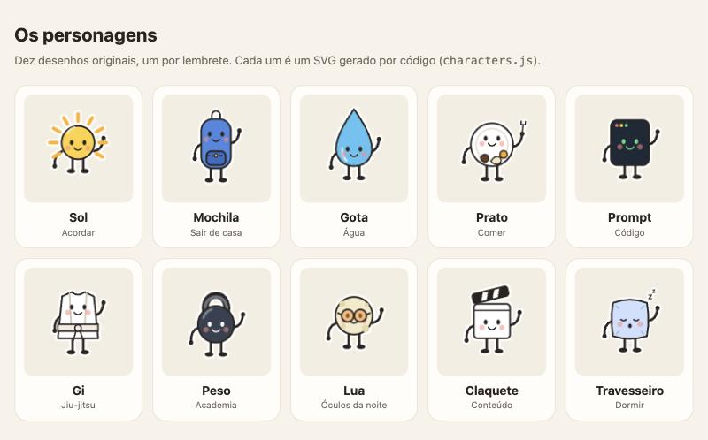

# Turma do Dia

App de barra de menu para Mac que lembra os passos da rotina. Cada lembrete é um personagem: na hora,
um cartão aparece no canto da tela com o personagem, uma frase e dois botões, **Feito** e **+10 min**.
Uso pessoal; sem rede, sem conta, sem telemetria. Versão 0.1: funciona, mas ainda é um projeto novo.



Nasceu de um vídeo de alguém que fez um mascote para lembrar de alongar. Aqui os desenhos são outros,
originais, e cada passo da rotina tem o seu: Sol, Mochila, Gota, Prato, Prompt, Gi, Peso, Lua, Claquete
e Travesseiro. A galeria interativa está em `docs/personagens/index.html`.

## Requisitos

macOS 13 ou mais novo e Swift 6.2 ou mais novo (Xcode). Sem dependências externas.

## Rodar

```sh
# testes do núcleo
swift test --scratch-path ~/.cache/turma-build

# montar o app em build/Turma.app (assinatura ad-hoc)
./scripts/build-app.sh
open build/Turma.app
```

O diretório de build fica fora do projeto (`--scratch-path`) de propósito: se a pasta estiver no iCloud,
o build dentro dela fica lento e o `codesign` recusa os atributos que o iCloud põe nas pastas `.app`.

Para desenvolvimento, sem mexer nos seus arquivos de verdade:

```sh
build/Turma.app/Contents/MacOS/Turma --show gota --slow \
  --state-dir /tmp/turma --config /tmp/turma/reminders.json
```

| Flag | O que faz |
| --- | --- |
| `--config <arquivo>` | arquivo de horários (padrão: `<state-dir>/reminders.json`) |
| `--state-dir <pasta>` | onde ficam os horários e o histórico |
| `--show <personagem>` | mostra um cartão de teste ao abrir |
| `--slow` | animações em câmera lenta |

## Horários

Na primeira vez o app cria `~/Library/Application Support/Turma/reminders.json` com um lembrete por
personagem. Ele nunca é sobrescrito: edite, salve e use **Recarregar horários** no menu.

```json
{
  "cardSeconds": 90,
  "snoozeMinutes": 10,
  "reminders": [
    {
      "id": "agua",
      "character": "gota",
      "title": "Hora da",
      "word": "água!",
      "subtitle": "Um copo agora, antes de esquecer.",
      "enabled": true,
      "schedule": { "every": 120, "from": "09:00", "to": "19:00" }
    }
  ]
}
```

- `schedule` usa **ou** `at` (lista de horas `HH:mm`) **ou** `every` (minutos, com `from` e `to`; o primeiro
  disparo é em `from` e o último não passa de `to`).
- `days` é opcional: `seg`, `ter`, `qua`, `qui`, `sex`, `sab`, `dom`. Sem `days`, todos os dias.
- Personagens: `sol`, `mochila`, `gota`, `prato`, `prompt`, `gi`, `peso`, `lua`, `claquete`, `travesseiro`.
- Se o arquivo tiver erro, o app diz qual lembrete e o que está errado. Ao abrir, fica sem lembretes até você corrigir; ao recarregar, mantém os horários de antes.

O histórico (`historico.json`, mesma pasta) conta por dia quantos lembretes foram feitos, adiados e
ignorados (o cartão fechou sozinho). Fica só no seu Mac.

## Como funciona

- `TurmaCore`: horários, validação, agendador e histórico. Sem interface, coberto por testes com relógio
  e fuso fixos.
- `Turma`: o app (AppKit). O cartão é uma página web local (`Sources/Turma/Resources/web/`) num `WKWebView`
  transparente; a página e o app conversam por `window.turma.show/celebrate` e mensagens `turma`.
- Um cartão por vez: lembretes que vencem juntos entram em fila. Depois que o Mac dorme, lembrete atrasado
  mais de 15 minutos é descartado.

## Licença

MIT. Veja `LICENSE`.
